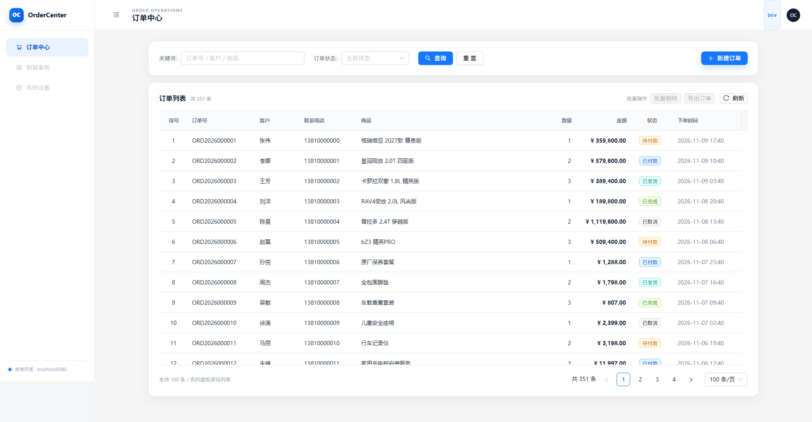

# OrderCenter 订单中心

一个用于学习前后端全栈协作的订单中心骨架。

- 后端：Spring Boot 3.5 + Java 21 + Spring Data JPA + MySQL 8 + Flyway + Swagger
- 前端：Vue 3 + TypeScript + Vite + Ant Design Vue 4 + Pinia + vxe-table
- 当前里程碑：跑通「数据库 → 后端分页接口 → 前端分层组件 → 路由页面」的订单列表链路
- 演示数据：350 条订单

> 当前是骨架版本，包含订单查询、搜索、状态筛选和分页；新增 / 编辑 / 删除会在下一阶段补齐。



## 目录结构

```text
OrderCenter/
├── backend/                          # Spring Boot 后端
│   ├── src/main/java/com/ordercenter/
│   │   ├── common/                   # ApiResponse、PageResult
│   │   ├── exception/                # 全局异常处理
│   │   └── order/                    # 订单实体、Repository、Service、Controller、DTO
│   ├── src/main/resources/
│   │   ├── application.yml
│   │   └── db/migration/             # Flyway：建表 + 演示数据
│   ├── pom.xml
│   ├── mvnw / mvnw.cmd
│   └── .mvn/
├── frontend/                         # Vue 3 前端
│   └── src/
│       ├── api/                      # Axios 实例 + 接口函数
│       ├── components/
│       │   ├── ui/                   # ① UI 基础组件：BaseTable
│       │   ├── business/             # ② 业务组件：BusinessTable
│       │   └── page/                 # ③ 页面级布局：TableView
│       ├── pages/order/              # ④ 路由级页面：OrderCenterPage
│       ├── layouts/                  # 后台外壳（侧边栏、顶栏）
│       ├── router/                   # 路由里引入页面级组件
│       ├── stores/                   # Pinia：筛选、分页、总数
│       ├── constants/                # 状态枚举、Tag 颜色
│       ├── types/                    # 订单、分页、表格类型
│       ├── utils/                    # 金额、时间格式化
│       └── assets/styles/
├── docs/order-center.png             # 运行界面截图
├── docker-compose.dev.yml            # 本地开发 MySQL
├── .env.example
└── README.md
```

## 代码约定

- Vue 单文件组件统一按 **`<template>` → `<script setup>` → `<style>`** 的顺序书写。
- UI 基础组件放在 `components/ui`，业务组件放在 `components/business`，页面级布局组件放在 `components/page`，路由级页面放在 `pages`。
- 业务组件不要直接 import 具体 API，通过父组件传入的 props 获取接口。
- 页面级布局组件负责组装业务组件和布局插槽；路由级页面只负责提供插槽内容与注入 API。

## 前端分层组件设计

```text
路由 router/index.ts
  └── 路由级页面 pages/order/OrderCenterPage.vue
        ├── Pinia store：筛选条件 / 分页 / 总数
        ├── 引入 getOrderList（API 函数）
        └── 页面级布局组件 components/page/TableView.vue
              ├── #filters 插槽        ← 查询条件 + 新建按钮
              ├── #batch-actions 插槽  ← 表格顶部批量操作
              └── 业务组件 components/business/BusinessTable.vue
                    ├── props.fetchApi ← 路由页经 TableView 注入
                    ├── 负责加载数据、处理 loading / error / 分页
                    └── UI 基础组件 components/ui/BaseTable.vue
                          └── 基于 vxe-table，开启虚拟滚动
```

职责边界：

1. **UI 基础组件 `BaseTable.vue`**
   - 只负责表格渲染和虚拟滚动。
   - 不认识订单、不调用接口。
   - 通过 `columns`、`data`、`height`、`virtual` 等 props 复用。
   - 单元格自定义通过 `#cell-{column.key}` 插槽交给业务层。

2. **业务组件 `BusinessTable.vue`**
   - 负责订单列表的数据获取、分页、错误和加载状态。
   - 不直接 import API，而是通过 `fetchApi` prop 接收，方便替换接口、写测试或复用到其他页面。
   - 从 Pinia 读取筛选条件与分页状态。
   - 提供 `#toolbar` 插槽，用来承载表格顶部的批量操作。

3. **页面级布局组件 `TableView.vue`**
   - 负责组装筛选卡片和业务表格，统一页面布局。
   - 对外提供 `#filters` 和 `#batch-actions` 两个插槽。
   - 把 `fetchApi` 透传给 BusinessTable，把批量操作转发到 BusinessTable 的 `#toolbar`。

4. **路由级页面 `OrderCenterPage.vue`**
   - 引入具体 API 和 TableView。
   - 传入查询条件、新建按钮和批量操作等插槽内容。
   - 不直接写表格渲染和页面布局细节。

5. **路由**
   - `router/index.ts` 通过懒加载引入路由级页面，路由本身不关心表格和服务端细节。

## 环境要求

- JDK 21
- Node.js 18+（当前锁定 Vite 5 兼容 Node 18；建议后续升级到 Node 22 LTS）
- Docker Desktop（用于本地 MySQL）
- 已配置 Docker 镜像加速（拉取 mysql:8.0 需要）

## 启动步骤

### 1. 启动 MySQL

在项目根目录执行：

```powershell
Copy-Item .env.example .env   # 可选，不复制也会使用默认值
docker compose -f docker-compose.dev.yml up -d
```

检查容器：

```powershell
docker compose -f docker-compose.dev.yml ps
```

首次启动会自动创建数据库 `order_center`。后端启动时 Flyway 自动建表并插入 350 条演示订单。

### 2. 启动后端

```powershell
cd backend
.\mvnw.cmd spring-boot:run
```

首次运行会下载 Maven 与依赖，耐心等待。

验证：

- 健康检查：http://localhost:8080/api/health
- Swagger UI：http://localhost:8080/swagger-ui.html
- 订单接口：http://localhost:8080/api/queryOrderList?page=1&size=20

示例响应：

```json
{
  "code": 0,
  "message": "ok",
  "data": {
    "records": [],
    "total": 350,
    "page": 1,
    "size": 20
  }
}
```

### 3. 启动前端

另开一个终端：

```powershell
cd frontend
npm install
npm run dev
```

打开 http://localhost:5173 。

Vite 已配置代理，`/api` 会转发到 `http://localhost:8080`，开发阶段不需要处理 CORS。

## 常用命令

```powershell
# 后端编译
cd backend
.\mvnw.cmd clean package -DskipTests

# 前端类型检查 + 构建
cd frontend
npm run build

# 停止 MySQL（保留数据）
docker compose -f docker-compose.dev.yml down

# 停止并清空数据库（下次启动重新执行 Flyway）
docker compose -f docker-compose.dev.yml down -v
```

## 数据库

- 数据库：`order_center`
- 用户：`order` / `order123`（默认开发配置）
- 表：`orders`
- Flyway 脚本：
  - `V1__create_orders.sql`：建表
  - `V2__seed_orders.sql`：基础演示数据 80 条
  - `V3__seed_more_orders.sql`：扩充 270 条，共 350 条

修改表结构时新增 `V3__*.sql`，不要改已经执行过的脚本。

## 接口约定

所有接口统一返回：

```json
{ "code": 0, "message": "ok", "data": ... }
```

| 方法 | 路径 | 说明 |
|---|---|---|
| GET | `/api/health` | 健康检查 |
| GET | `/api/queryOrderList?page=1&size=100&keyword=&status=` | 订单分页查询 |

`page` 从 1 开始，`size` 最大 200。`status` 可选值：

`PENDING` / `PAID` / `SHIPPED` / `COMPLETED` / `CANCELLED`

## 下一阶段

1. 新增 / 编辑订单弹窗与后端 `POST`、`PUT`
2. 删除、状态流转、统计卡片
3. 后端参数校验与接口测试
4. 生产 Docker Compose（Nginx + Spring Boot + MySQL）
5. AI 能力：自然语言查订单、订单摘要（放在业务闭环稳定之后）

## 已知依赖说明

- `vxe-table` 依赖 `xe-utils`，当前 `xe-utils@4.2.1` 的 npm 包缺少 `es/index.esm.js`，会导致 Vite 构建报 `Failed to resolve entry for package "xe-utils"`。
- 项目已在 `frontend/package.json` 中用 `overrides` 锁定 `xe-utils@4.1.5`，首次安装必须保留 `overrides`，不要单独升级 `xe-utils`。
- 当前依赖按 Node 18 可运行版本锁定（Vite 5）；如果升级到 Node 22，可以后续整体升级到 Vite 7/8。

## 调试建议

- 后端启动失败时，先看终端异常；权限、数据库连接、Flyway SQL 是高频问题。
- 前端 404 / 500：打开浏览器 Network 面板确认 `/api/queryOrderList` 的响应。
- 表格没有数据：先直接访问后端接口，确认返回 `records` 是否有值。
- 本地数据库状态异常：`docker compose -f docker-compose.dev.yml down -v` 清空后重启，Flyway 会重跑。
